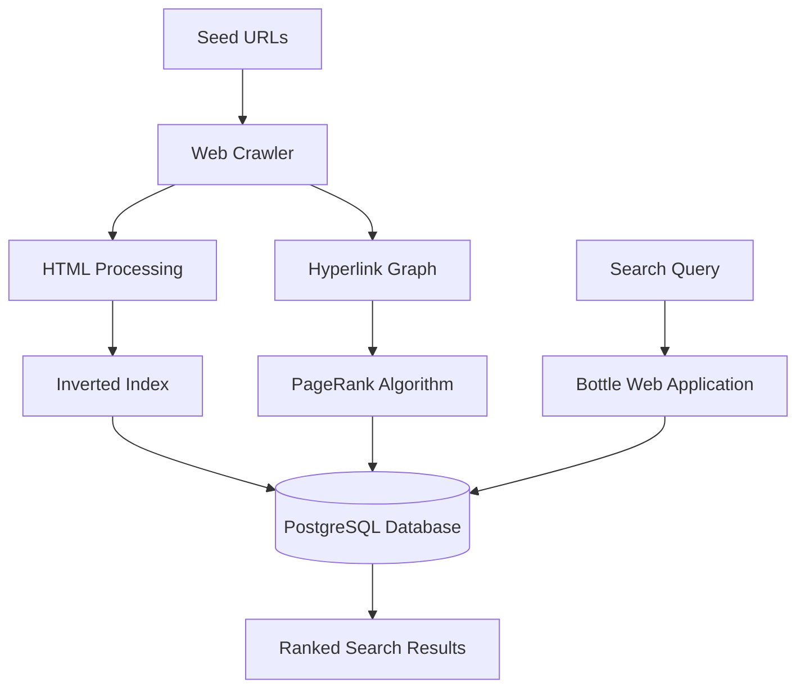

# Seekr — Search Engine

**Seek it, Find it.**

Seekr is a full-stack search engine built using **Python, PostgreSQL, and Bottle**. It implements web crawling, inverted indexing, and the PageRank algorithm to discover, index, and retrieve webpages based on user search queries.

The project explores how search engines process web content, organize information, and rank search results.

## Features

- **Web Crawler:** Discovers webpages by following hyperlinks from a set of seed URLs.
- **Inverted Index:** Maps keywords to indexed documents to support efficient searching.
- **PageRank Algorithm:** Calculates webpage importance using the hyperlink structure.
- **Keyword-Based Search:** Retrieves relevant webpages based on user queries.
- **Result Ranking:** Orders results by matching keywords and PageRank scores.
- **Pagination:** Organizes search results across multiple pages.
- **Custom Frontend:** A responsive search interface built with Bottle, HTML, and CSS.

## Tech Stack

- **Backend:** Python
- **Database:** PostgreSQL
- **Web Framework:** Bottle
- **Frontend:** HTML, CSS
- **Algorithms:** PageRank, Inverted Indexing

## System Architecture

## How It Works

1. **Crawling:** The crawler starts from predefined URLs and discovers additional webpages through hyperlinks.
2. **Indexing:** Webpage content is processed and stored in a PostgreSQL-backed inverted index.
3. **Ranking:** PageRank scores are calculated using the relationships between discovered webpages.
4. **Searching:** User queries are matched against indexed keywords.
5. **Displaying Results:** Matching webpages are ranked and displayed through the Seekr web interface.

## Running Locally

Running Locally

1. Clone the repository

git clone https://github.com/tasfiaraisa/search_engine.git
cd search_engine

2. Set up the Python environment

python3 -m venv .venv
source .venv/bin/activate
pip install -r requirements.txt

3. Configure PostgreSQL

Create a PostgreSQL database named search_engine and initialize the required tables using backend/schema.sql.

4. Run the crawler

cd backend
python crawler.py

5. Start the frontend

From the project root:

cd frontend
python app.py

Open http://localhost:8080 in your browser.

AWS Deployment & Performance Testing

Automated AWS EC2 infrastructure provisioning using Python, Boto3, Paramiko, and SCP, including instance configuration, Elastic IP allocation, and remote file transfer.

Performed HTTP load testing on an earlier EC2-hosted version using ApacheBench, with resource monitoring through dstat and iostat.

Benchmark Highlights

982.89 requests/second throughput

1,000 HTTP requests with 20 concurrent clients

0 failed requests

20.348 ms mean response time

View Full Performance Report

Note: Benchmarks reflect an earlier EC2-hosted HTTP workload, not the current PostgreSQL search implementation.
