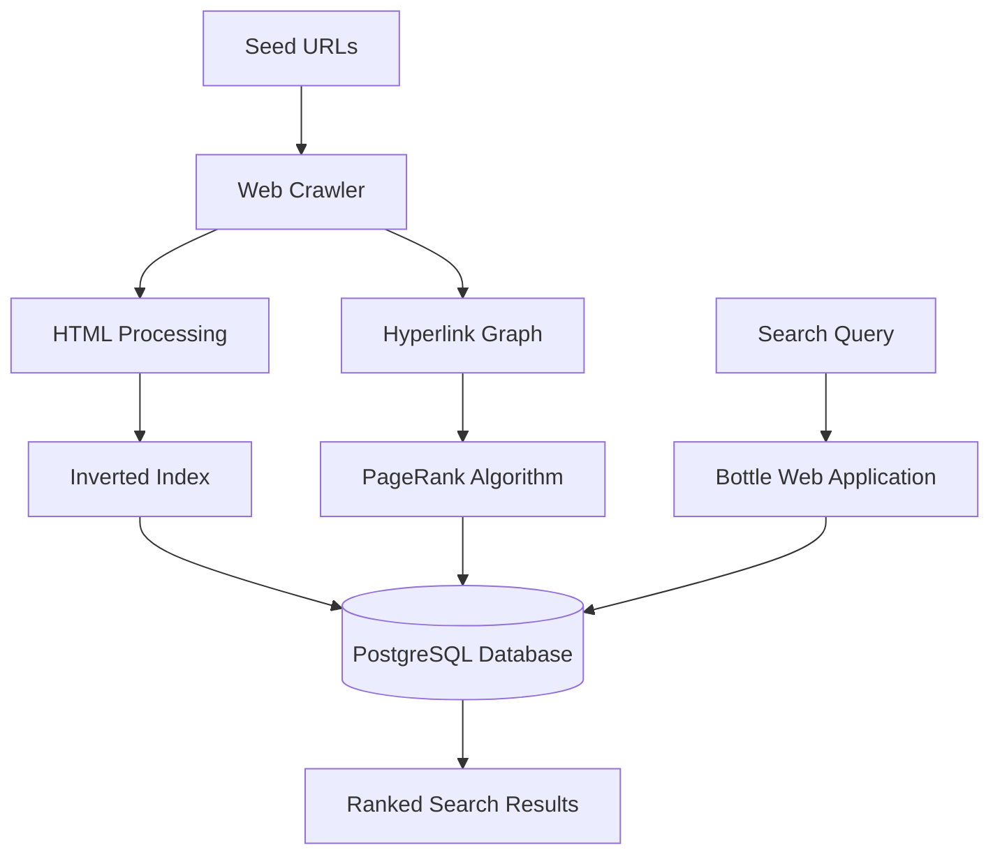

# Seekr — Search Engine

**Seek it, Find it.**

Seekr is a full-stack search engine built using **Python, PostgreSQL, and Bottle**. It implements web crawling, inverted indexing, and the PageRank algorithm to discover, index, and retrieve webpages based on user search queries.

The project explores how search engines process web content, organize information, and rank search results.

## Features

- **Web Crawler:** Discovers webpages by following hyperlinks from a set of seed URLs.
- **Inverted Index:** Maps keywords to indexed documents to support efficient searching.
- **PageRank Algorithm:** Calculates webpage importance using the hyperlink structure.
- **Keyword-Based Search:** Retrieves relevant webpages based on user queries.
- **Result Ranking:** Orders results by matching keywords and PageRank scores.
- **Pagination:** Organizes search results across multiple pages.
- **Custom Frontend:** A responsive search interface built with Bottle, HTML, and CSS.

## Tech Stack

- **Backend:** Python
- **Database:** PostgreSQL
- **Web Framework:** Bottle
- **Frontend:** HTML, CSS
- **Algorithms:** PageRank, Inverted Indexing

## System Architecture



## How It Works

1. **Crawling:** The crawler starts from predefined URLs and discovers additional webpages through hyperlinks.
2. **Indexing:** Webpage content is processed and stored in a PostgreSQL-backed inverted index.
3. **Ranking:** PageRank scores are calculated using the relationships between discovered webpages.
4. **Searching:** User queries are matched against indexed keywords.
5. **Displaying Results:** Matching webpages are ranked and displayed through the Seekr web interface.

## Running Locally

### 1. Clone the repository

```bash
git clone YOUR_REPOSITORY_URL
cd search_eng